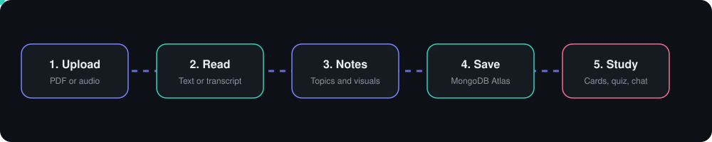

<p align="center">
  
</p>

<p align="center">
  
  
  
  
  
  
</p>

<p align="center">
  <b>Turn lecture recordings and PDF notes into organised study notes, flashcards, quizzes and an AI tutor you can chat with.</b>
</p>

---

## 🎯 The problem

Students struggle to revise long lecture recordings and messy notes before exams. This app reads a lecture, explains it topic by topic with simple visuals, and gives you the tools to test yourself, all in one place.

## ⚙️ How it works

<p align="center">
  
</p>

## ✨ Features

| 📚 Detailed notes | 🃏 Flashcards | 📝 Quizzes |
|---|---|---|
| Topic-by-topic explanations with flow charts, comparison tables and concept maps | Flip cards and mark each as known or needs revision | Easy, medium and hard levels with a score and a per-topic breakdown |

| 💬 Lecture chat | 🗂️ Saved library | 🖨️ Two PDF exports |
|---|---|---|
| Ask questions answered from your own notes, with a clear flag when something is not covered | Search, group by date, reopen or delete any lecture | A clean study PDF and a handwritten notebook-style PDF |

Also included: drag-and-drop upload with file checks, a progress indicator, and friendly messages for rate limits and errors.

## 🧰 Tech stack

| Layer | Tools |
|---|---|
| Frontend | React, Vite, plain CSS |
| Backend | Node.js, Express, Multer, pdf-parse |
| Database | MongoDB Atlas with Mongoose |
| AI | OpenAI API for transcription, notes, flashcards, quizzes and chat |

## 🚀 Getting started

```bash
git clone https://github.com/mohit20678/ai-lecture-summarizer.git
cd ai-lecture-summarizer

# 1. Backend
cd server
npm install
# create server/.env (see the table below)
node index.js

# 2. Frontend (in a second terminal)
cd client
npm install
npm run dev
```

Open the address Vite prints, usually `http://localhost:5173`.

### Environment variables

Create `server/.env`. Never commit this file.

| Variable | Purpose |
|---|---|
| `OPENAI_API_KEY` | Your OpenAI API key |
| `MONGO_URI` | MongoDB Atlas connection string |
| `PORT` | Server port, `5000` by default |
| `TRANSCRIBE_MODEL` | Optional: speech-to-text model name |
| `SUMMARY_MODEL` | Optional: text model name |

> [!NOTE]
> OpenAI's free tier has strict rate limits. If the app shows a rate-limit message, wait for the time it shows. Notes, flashcards and quizzes are saved, so each one is generated only once.

<details>
<summary><b>📁 Project structure</b></summary>

```
ai-lecture-summarizer/
├── client/                 React + Vite frontend
│   └── src/
│       ├── components/     UploadBox, ResultCard, Visual, LectureList, StudyTools
│       └── exportHandwritten.js   PDF export builders
├── server/                 Node.js + Express API
│   ├── routes/             upload, notes, study, health
│   ├── services/           ai.js (transcription and notes)
│   ├── models/             Note.js (MongoDB schema)
│   └── index.js
├── assets/                 README images
└── start-all.bat           One-click start on Windows
```

</details>

## 🧠 Engineering notes

- **Secrets stay on the server.** The browser never sees the API key.
- **Uploads are deleted** right after processing, so lecture files are not kept.
- **AI output is repaired and validated.** Language models sometimes return slightly broken JSON, so the server fixes stray brackets, retries once, and shows an error instead of saving bad data.
- **Results are cached.** Flashcards and quizzes are saved per lecture, so reopening them costs no extra AI requests.
- **Clear errors.** Rate limits, unsupported files and missing connections each get a plain-language message.

## 🗺️ Roadmap

- [x] PDF upload and detailed AI notes with visuals
- [x] Saved lecture library with search
- [x] Flashcards, quizzes and lecture chat
- [x] Study PDF and handwritten PDF export
- [ ] More testing of the audio path (MP3, WAV, M4A)
- [ ] Timestamped transcript with audio player
- [ ] Mind maps and formula extraction
- [ ] Revision mode and knowledge-gap tips
- [ ] YouTube links, browser recording and PPT upload
- [ ] User accounts and deployment

<!--
Add screenshots later: save images as assets/home.png and assets/notes.png,
then replace this comment with:

## 📸 Screenshots
<p align="center">
   
</p>
-->

## 👨‍💻 Author

Built by **Mohit Hedau**, a first-year CSE student learning by shipping real projects.
[GitHub](https://github.com/mohit20678)

<p align="center">If this project helped you, consider giving it a ⭐</p>
